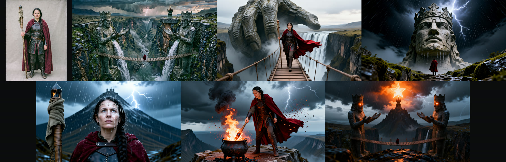
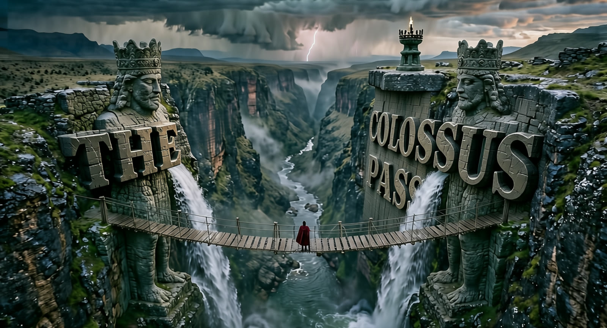

# Open Cinema Studio

**Write a shot list. Get a film.** An open-source, open-weights take on "cinema studio" apps, built on ComfyUI.

You describe the world and the lead character, then plan shots like a director: shot size, camera move (dolly, crane, orbit, whip pan, dolly zoom and more), film look, duration and sound. Open Cinema Studio then:

1. **Casts the lead.** HiDream-O1-Image renders a studio reference portrait from your character description. You can also upload a photo of a real actor instead.
2. **Establishes the world.** HiDream-O1-Image renders the opening keyframe at 2560×1440.
3. **Shoots coverage.** Every later keyframe is made by Qwen-Image-Edit-2511 (4-step Lightning) from two references. *Picture 1* is the establishing frame, which sets the world, light and grade. *Picture 2* is the cast portrait, which sets the face, hair and wardrobe. It samples onto a blank canvas at the film's aspect ratio, so the references guide identity without copying composition. Characters stay consistent from shot to shot without any LoRA training.
4. **Rolls camera.** LTX 2.5 animates each keyframe at 1280×704 with the camera move you picked. Each keyframe is composed as the *first frame* of its move (a drone shot starts aerial). Forward moves (drone, dolly, push-in, crash zoom, FPV dive) also get a **camera-path guide**, a zoomed end frame that pulls the shot forward, so the camera really travels instead of drifting. It **generates synchronized audio in the same pass**, so ambience, footsteps and effects come from the model itself.
5. **Does one-takes.** Set a shot to *Continue* and it starts on the exact last frame of the previous shot. Chains of these become one unbroken camera move, and the duplicated seam frame is dropped in the edit.
6. **Cuts the film.** Shots are joined with hard cuts or dissolves. Audio gets de-click fades and the whole film is loudness-normalized to −16 LUFS. An optional film finish adds grain, a soft vignette and crisper edges.
7. **Masters in 1080p.** SeedVR2 3B restores and upscales the final cut to 1920×1056 in one diffusion step, keeping the audio.

Everything runs locally on open weights, with no partner nodes and no closed APIs.

**Sample films:** [The Colossus Pass](docs/media/the-colossus-pass.mp4) (6 shots, epic fantasy, in-world title carved by AI, credits, 1080p SeedVR2 master), its [trailer cut](docs/media/the-colossus-pass-trailer.mp4) and [Night Courier](docs/media/night-courier.mp4) (6 shots, 25 s, neon chase).





> Entry for Comfy's [Open Source Higgsfield](https://comfy.org/open-source-higgsfield) challenge. Target category: **Open Weights Only**, plus the **LTX** bonus (LTX 2.5 is the core video model).

## How it works

```
 lead description ──► HiDream-O1 ──► cast portrait ───────────────────┐   (or upload a photo)
 world + shot 1 ────► HiDream-O1 ──► establishing keyframe ──────────┤
                                                                        ▼
 shot 2..n ──► Qwen-Image-Edit-2511 + Lightning (Picture 1 = world, Picture 2 = cast, blank 16:9 canvas) ──► keyframes
 keyframe + camera move + action + sound ──► LTX 2.5 (2-stage distilled, x2 latent upscale, audio) ──► shot.mp4
 "Continue" shots ──► last frame of previous shot ──► LTX 2.5
 all shots ──► cuts / dissolves / one-take seams + de-click + loudnorm (+ film finish) ──► film.mp4
 film.mp4 ──► SeedVR2 3B (1 step, x1.5) ──► 1920×1056 master
```

| Piece | What it is |
| --- | --- |
| `app/` | Web studio: a stdlib-only Python server, a GPU job queue and the UI, all driving ComfyUI over its HTTP API |
| `app/graphs.py` | The ComfyUI graphs (core nodes only): keyframe, coverage, and LTX shot with audio |
| `custom_nodes/comfyui-open-cinema/` | **Open Cinema** node pack: camera-direction vocabulary as ComfyUI nodes. *Open Cinema Shot* turns scene, action, shot size, camera move, look and sound into keyframe, coverage and motion prompts. *Open Cinema Shot Length* converts seconds to LTX-valid frame counts |
| `workflows/` | The same graphs as API-format JSON you can drop into ComfyUI |

The camera language is the core of the app. `director.py` maps 22 camera moves, 12 shot sizes and 12 film looks to phrasing that LTX 2.5 and Qwen follow reliably. In the UI, each camera move also has a tiny animated viewfinder preview.

## Titles & Motion

Kinetic typography and motion graphics, built into the cut. **They take on each film's look.** *70mm epic* gets gold Fraunces serif on charcoal, *Neon cyberpunk* gets Barlow with magenta and cyan, and *None* gets black and orange. Everything is rendered by the Open Cinema node pack, so it runs inside ComfyUI and is usable in any workflow.

| Option | What it does |
| --- | --- |
| **Main title** | The film's title slams in over the opening shot. The glowing line streaks through, a starburst flashes, and the subtitle is typed out underneath. |
| **In-world title (AI)** | Instead of overlaid type, the title **becomes part of the world**. Qwen-Image-Edit-2511 builds it into the establishing frame in a material that suits the look: carved stone for *70mm epic*, a neon sign for *Neon cyberpunk*, brush calligraphy for *Anime*, or your own words. LTX 2.5 then brings the scene alive around the steady lettering, using a gentle push-in camera path. Spelling is reliable because the exact lettering is first set in the film's typeface by the **Open Cinema Type Sheet** node and handed to the editor as Picture 2. It opens the film and dissolves into shot 1, with its own frame and motion takes. |
| **Shot stamps** | A HUD slate on each later shot, e.g. `SHOT 03 · LOW ANGLE · TILT UP`, with the camera move highlighted. |
| **End credits** | Kinetic credit cards, one per line (`LABEL | TEXT`), scored with the last shot's own LTX sound echoing out. |
| **Trailer cut** | An alternate cut: your tagline cards between the strongest stretch of each shot. Its soundtrack is **one continuous score composed by LTX 2.5**, generated from the film's dark title card so the model writes music rather than scene ambience, in a style matched to the look (an orchestral epic, synthwave, a horror sting…). Every cut snaps to a hit in that score, and the trailer ends on a title card. **New score** re-rolls the music. |

Each option is a switch in the cut room's **Titles & Motion** panel. The 1080p master re-renders the graphics at full resolution. Rendered graphics are cached by content, so re-cutting only redraws what changed.

Nodes: *Open Cinema Title Overlay*, *Open Cinema Shot Stamp*, *Open Cinema Cards (kinetic type)*, *Open Cinema Title Preview* and *Open Cinema Type Sheet*. Fonts are bundled under the SIL Open Font License: Barlow Condensed, Fraunces, Manrope and JetBrains Mono.

## Requirements

- ComfyUI v0.43 or newer (Desktop or portable is fine). LTX 2.5 and Qwen-Image nodes are part of core ComfyUI.
- An NVIDIA GPU with 24 GB of VRAM. Developed on an RTX 5090 Laptop GPU (24 GB) with 64 GB of system RAM.
- Python 3.10+ for the studio server. It uses the standard library only, so there's nothing to `pip install`.
- `ffmpeg` on your PATH (used for the final cut and for one-take continuations).

### Models (open weights, permissive licenses)

Every model in the pipeline allows commercial use. Nothing is research-only.

| ComfyUI folder | File | Source | License |
| --- | --- | --- | --- |
| `checkpoints` | `hidream_o1_image_fp8_scaled.safetensors` | [Comfy-Org/HiDream-O1-Image](https://huggingface.co/Comfy-Org/HiDream-O1-Image) | MIT |
| `diffusion_models` | `qwen_image_edit_2511_int8_convrot.safetensors` | [Comfy-Org/Qwen-Image-Edit](https://huggingface.co/Comfy-Org/Qwen-Image-Edit) | Apache-2.0 |
| `text_encoders` | `qwen_2.5_vl_7b_fp8_scaled.safetensors` | [Comfy-Org/Qwen-Image](https://huggingface.co/Comfy-Org/Qwen-Image) | Apache-2.0 |
| `vae` | `qwen_image_vae.safetensors` | [Comfy-Org/Qwen-Image](https://huggingface.co/Comfy-Org/Qwen-Image) | Apache-2.0 |
| `loras` | `Qwen-Image-Edit-2511-Lightning-4steps-V1.0-bf16.safetensors` | [lightx2v/Qwen-Image-Edit-2511-Lightning](https://huggingface.co/lightx2v/Qwen-Image-Edit-2511-Lightning) | Apache-2.0 |
| `diffusion_models` | `ltx-2.5-22b-distilled-transformer-comfy-int8-convrot.safetensors` | [Lightricks/LTX-2.5](https://huggingface.co/Lightricks/LTX-2.5) | [LTX-2.x Community License](https://github.com/Lightricks/LTX-2/blob/main/LICENSE-2_x) (free under $10M revenue) |
| `text_encoders` | `gemma4-12b-with-proj-ltx-2.5-comfy-int8-convrot.safetensors` | [Lightricks/LTX-2.5](https://huggingface.co/Lightricks/LTX-2.5) | LTX-2.x Community License |
| `vae` | `ltx-2.5-video-vae-bf16.safetensors`, `ltx-2.5-audio-vae-bf16.safetensors` | [Lightricks/LTX-2.5](https://huggingface.co/Lightricks/LTX-2.5) | LTX-2.x Community License |
| `latent_upscale_models` | `ltx-2.5-latent-spatial-upscaler-x2-bf16-1.0.safetensors` | [Lightricks/LTX-2.5](https://huggingface.co/Lightricks/LTX-2.5) | LTX-2.x Community License |
| `diffusion_models` | `seedvr2_3b_int8_convrot.safetensors` (1080p master) | [Comfy-Org/SeedVR2](https://huggingface.co/Comfy-Org/SeedVR2) | Apache-2.0 |
| `vae` | `seedvr2_ema_vae_fp16.safetensors` (1080p master) | [Comfy-Org/SeedVR2](https://huggingface.co/Comfy-Org/SeedVR2) | Apache-2.0 |
| `text_encoders` | `gemma4_e4b_it_fp8_scaled.safetensors` (AI lead writer) | [Comfy-Org/gemma-4](https://huggingface.co/Comfy-Org/gemma-4) | Apache-2.0 |

The LTX 2.5 repo is gated, so accept its terms on Hugging Face before downloading. Together the models take about 84 GB of disk.

Why these models: on the Artificial Analysis leaderboards, HiDream-O1-Image is the strongest MIT/Apache text-to-image model that runs on a 24 GB GPU, and Qwen-Image-Edit-2511 is the strongest Apache-licensed multi-reference editor. A few open models score higher, but they are research-only or non-commercial, so this project doesn't use them. LTX 2.5 is the newest LTX, and it generates video and audio together.

## Setup

1. Put the models in your ComfyUI `models/` folders, or point ComfyUI at wherever they live using [`extra_model_paths.example.yaml`](extra_model_paths.example.yaml).
2. Optional: to use the Open Cinema nodes inside ComfyUI, copy or symlink `custom_nodes/comfyui-open-cinema` into `ComfyUI/custom_nodes/`, or add `custom_nodes:` to your extra model paths file.
3. Start ComfyUI (default `http://127.0.0.1:8188`).
4. Start the studio:

   ```bash
   python app/server.py --comfy http://127.0.0.1:8188 --open
   ```

5. Open `http://127.0.0.1:8420`, write the world, add shots and press **Render film**.

## Using it

- **✨ Generate the whole story:** type a spark (or nothing) and Gemma 4 E4B writes the whole Story page: title, logline, world, a look with its own colour palette, the lead and continuity notes. Then it casts the lead's portrait. Each field also has its own ✨ (Title, Logline, World, Look & colours) that rewrites just that field so it stays consistent with the rest. **Undo AI change** reverts only what the AI touched. In ComfyUI, the *Open Cinema Story Brief* and *Open Cinema Parse Story* nodes wrap `TextGenerate` (workflow `11_ai_story_writer_gemma4.json`).
- **Look** sets the film's color and lens language. It goes into every keyframe and motion prompt. **Colours** let you tune the film's background, ink, accent and glow. They tint the studio and every title, card and HUD overlay. Picking a look brings back that look's colours.
- **Lead character**: describe your lead, then press **Cast from description**, or let **Render film** cast them automatically. You can drop a photo instead, and every shot keeps that face.
- **Continuity notes** are the few details that must never change, such as a prop or a scar.
- **✨ AI lead writer:** a local open LLM, **Gemma 4 E4B-it** (Apache-2.0) running through ComfyUI's native `TextGenerate` node, writes the lead and the continuity notes. It has three modes:
  - **Write with AI** invents a lead who belongs to your world, era and look.
  - **Refine** keeps every detail you wrote and makes it camera-ready.
  - **Describe photo** describes your cast photo exactly.

  **✨ From the lead** distills the continuity notes from the lead. Every change can be undone. In ComfyUI, the *Open Cinema Lead Brief* and *Open Cinema Parse Lead* nodes wrap `TextGenerate` (workflow `10_ai_lead_writer_gemma4.json`).
- **Lead** (per shot): untick it for landscape or object shots. Those shots are generated free of people, and every shot with the lead says she is the only person in frame, which keeps busy backgrounds from filling with extras.
- **Shots**: each shot has an action, a size, a camera move (shown live in the little viewfinder), its length in seconds, and sound.
  - **New keyframe** re-rolls only that shot's frame. **Upload** uses your own frame. **Render shot** animates it.
  - **Cut to** starts from a fresh coverage keyframe. **Dissolve** crossfades picture and sound. **Continue (one take)** starts on the previous shot's last frame.
- **Takes**: **New keyframe** and **Render shot** never overwrite. Every attempt becomes a numbered take (K1, K2… for frames, S1, S2… for shots) that you can switch between under the frame. Each take gets its own reproducible seed.
- **Film finish** (optional) adds fine animated grain, a soft vignette and gentle sharpening to the cut.
- **Master in 1080p** runs SeedVR2 on each shot (cached per take), then re-cuts the film at 1920×1056 with the same transitions and audio.
- **Render film** queues whatever is missing: casting, then all keyframes, then all shots, so ComfyUI swaps the Qwen and LTX weights only once. It then cuts the film.

Approximate timings on an RTX 5090 Laptop GPU (24 GB):

| Step | Time |
| --- | --- |
| Cast portrait or establishing keyframe (HiDream-O1, 40 steps, 2560×1440) | about 1.5–2 min |
| Coverage keyframe (Qwen-Image-Edit-2511 + Lightning, two references) | about 25 s |
| 4-second shot with audio at 1280×704 | about 45 s |
| 1080p master (SeedVR2 3B), per 4-second shot | about 4.5 min |

A 6-shot, 25-second film renders in about 11 minutes. Mastering it in 1080p adds about 27 minutes.

## Running single steps in ComfyUI

`workflows/` holds the exact graphs the app sends. Regenerate them with `python tools/export_workflows.py`.

- `00_cast_portrait_hidream_o1.json`: cast reference portrait
- `01_keyframe_hidream_o1.json`: establishing keyframe
- `02_coverage_qwen_image_edit_2511.json`: a new setup of the same scene (inputs are `establishing_keyframe.png` and `cast_portrait.png`)
- `03_shot_ltx25_i2v_audio.json`: image-to-video with audio and camera direction
- `04_shot_ltx25_keyframe_to_keyframe.json`: lands the shot on a chosen end frame
- `05_director_node_keyframe_to_keyframe.json`: the same shot, with its motion prompt written by the **Open Cinema Shot** node (requires the node pack)
- `06_master_1080p_seedvr2.json`: SeedVR2 1080p master of a finished film (input `film.mp4`), audio kept
- `07_motion_title_over_shot.json`: main title over a shot (input `shot.mp4`), audio kept
- `08_motion_kinetic_cards.json`: kinetic type cards (`LABEL | TEXT` per line)
- `09_inworld_title_frame.json`: an in-world title built into a frame (input `establishing_keyframe.png`), with the type sheet as Picture 2
- `10_ai_lead_writer_gemma4.json`: Gemma 4 E4B writes a lead and continuity notes from a world (Lead Brief → TextGenerate → Parse Lead)
- `11_ai_story_writer_gemma4.json`: Gemma 4 E4B writes a whole story page (title, logline, world, look, palette, lead, continuity) from a spark (Story Brief → TextGenerate → Parse Story)

## License

The code is MIT licensed (see [LICENSE](LICENSE)). The model weights keep their own licenses, listed above.
